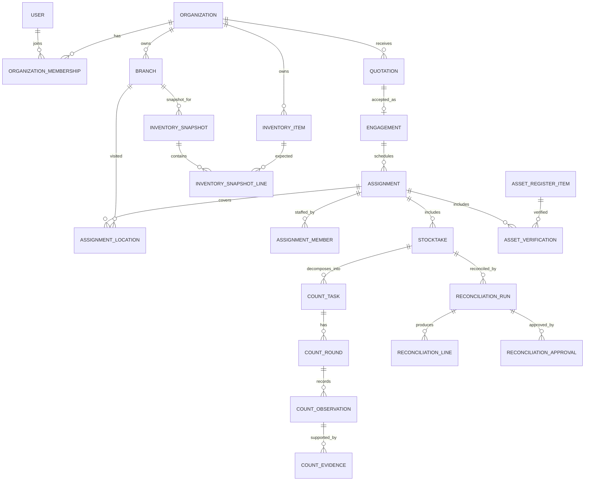

# Veristock One — Domain Model

**Status:** Proposed MVP domain model  
**Scope:** Client inventory verification, physical stocktaking, reconciliation, fixed asset verification and commercial operations.  
**AI policy:** No AI functionality or AI-related dependencies.

## 1. Modelling principles

1. A client business is a tenant. Its inventory, branches, stocktakes, reports and files are tenant-owned.
2. Veristock is the platform operator and also an organization in the identity model, but its platform privileges are distinct from client membership permissions.
3. A login identity is a person (`User`); authorization comes from active organization membership, role grants and resource-level policy.
4. Expected inventory, physical observations and approved reconciliation are separate facts.
5. A submitted count is immutable. Recounts create new rounds and observations; they do not rewrite prior submissions.
6. Reconciliation uses a frozen expected-stock snapshot and a selected submitted/approved count round.
7. Published reports refer to approved result versions.
8. Financial variance requires a supplied, verified unit cost and currency.
9. State transitions and approvals are explicit and audited.
10. Quantities and monetary amounts use decimal/numeric types, never binary floating point.

## 2. Organization, identity and access

### User
A global login identity.

Key attributes: `id`, `identifier` (email for the current login flow), `password_hash`, `status` (active/suspended/disabled), `created_at`. The current schema retains the original `identifier` column to preserve the foundation migration history.

Email uniqueness should be normalized consistently (case-insensitive). A user can belong to multiple organizations.

### Organization
Represents either the Veristock platform organization or a client business.

Key attributes: `id`, `kind` (`platform` | `client`), `legal_name`, `trading_name`, `registration_number`, `tax_identifier` (optional), `email`, `phone`, `address`, `timezone`, `status`.

Only one active platform organization should exist in the initial deployment. Client organization records are tenant roots.

### OrganizationMembership
Joins a user to an organization.

Key attributes: `id`, `organization_id`, `user_id`, `status`, `joined_at`, `invited_by_user_id`, `created_at`.

Unique constraint: `(organization_id, user_id)`.

### Role, Permission, MembershipRole, RolePermission
Roles are assigned to memberships, not globally to users. Permissions are stable codes and roles are permission bundles. Platform roles and client roles have different scopes. The initial role/permission catalogue is seeded by migration `0004_tenancy_rbac`. The authorization query requires role scope to match organization kind, preventing a client role from being used in the platform organization or vice versa. Avoid a single `is_admin` boolean.

### Branch
A physical client location.

Key attributes: `id`, `organization_id`, `code`, `name`, `address`, `county`, `contact_name`, `contact_phone`, `status`.

Unique constraint: `(organization_id, code)`.

### ClientContact
Contact person associated with a client organization and optionally a branch. A portal user is linked through User/Membership; a contact record alone does not grant login access.

## 3. Workforce

### EmployeeProfile
Veristock employee details associated with a User and an internal organization membership.

Attributes may include employee number, employment status, phone, job title, skills, certifications and emergency contact fields (collect only what is operationally necessary).

### EmployeeAvailability
Date/time availability or leave blocks used for assignment scheduling.

### AssignmentMember
Associates an employee membership with an assignment and optionally a specific branch/count scope. Captures assigned role (lead/counter/supervisor), allocation and status.

Do not equate employee profile with a client membership. Internal employee access is granted through Veristock organization membership and assignment scope.

## 4. Commercial and operational planning

### Quotation
Belongs to a client organization. Contains quotation number, issue/expiry dates, currency, line items, scope, assumptions, exclusions, tax/discount treatment, subtotal, tax and total, status, and version.

Quotation line items describe service and price units (for example, branch, item count, asset count, day or fixed fee). Preserve accepted quotation versions.

Suggested states: `draft -> sent -> accepted | rejected | expired | withdrawn`.

### Engagement
Represents an accepted commercial instruction/contract for a defined service scope.

Attributes: client organization, accepted quotation/version (optional for manually authorized engagement), reference, scope, start/end dates, agreed terms snapshot, status and owner.

Suggested states: `draft -> active -> completed`; cancellation/termination are explicit transitions with reason and actor.

### Assignment
A unit of operational work under an engagement. It has service type, scheduled window, priority, status, instructions, responsible supervisor and deliverables.

Suggested states: `draft -> scheduled -> in_progress -> submitted_for_review -> completed`; `cancelled` is a separate terminal path.

### AssignmentLocation
Links an assignment to one or more client branches and optional sub-locations/zones.

### Invoice and Payment
Invoice records are generated from an engagement or completed service milestone. Payment records track amount, currency, reference, date and allocation. MVP billing should track invoices and payments; it should not claim to be a full accounting ledger or tax-compliance engine.

## 5. Inventory domain

### InventoryCategory
Tenant-owned classification hierarchy or flat category list.

### UnitOfMeasure
Controlled unit catalogue (each, box, carton, kilogram, litre, metre, etc.). Unit conversions must be explicit and versioned where they affect reconciliation.

### InventoryItem
Tenant-owned item master. Suggested fields:
- `id`, `organization_id`, `sku` (nullable where client has no SKU);
- `barcode` (nullable);
- `name`, `description`, `category_id`;
- `base_uom_id`, optional brand/model;
- tracking policy: none, lot/batch, serial, expiry;
- active/inactive status.

Use tenant-scoped uniqueness for non-null SKU and barcode, with PostgreSQL partial unique indexes where appropriate. Never assume barcode is globally unique across clients.

### InventoryImport
Tracks the source file, branch/scope, uploader, import mapping, validation summary, status, source checksum and timestamps.

Suggested states: `uploaded -> validating -> needs_correction | ready_to_commit -> committed`; failed imports retain diagnostic information. The raw file is retained under a controlled object-storage key.

### InventorySnapshot
Immutable expected-stock snapshot for an organization/branch and an effective stock cut-off. Store source import provenance, currency/cost basis metadata and version.

### InventorySnapshotLine
Expected quantity for an item and optional location, lot/batch, serial number and expiry date. Includes the unit of measure and, if provided and verified, unit cost and currency.

A corrected source file creates a new import and snapshot. Never mutate the snapshot used by an existing reconciliation run.

### InventoryLocation
Optional client-defined location hierarchy within a branch (warehouse, room, aisle, rack, shelf, bin). A count may operate at branch level if the client does not provide finer location data.

## 6. Stocktaking domain

### Stocktake
A physical verification exercise under an assignment. Defines branch/location scope, inventory cut-off, counting method, tolerances, instructions and status.

A stocktake references the expected-stock snapshot(s) selected for reconciliation. Once counting begins, snapshot identity and cut-off must be fixed or a controlled re-baseline operation must create a new version and audit event.

Suggested states: `planned -> ready -> counting -> submitted -> under_review -> approved -> closed`. A stocktake may be cancelled with reason.

### CountTask
A work unit assigned to an employee/team for a branch, zone, category or bounded item scope. Contains task instructions and blind-count policy.

### CountRound
A numbered round for a count task. Initial count is round 1; recount is round 2 or later. Stores counter, start/submission times, status, reason for recount (when applicable) and predecessor round.

Suggested states: `open -> submitted -> accepted | recount_requested`. Submitted rounds are immutable.

### CountObservation
A physical observation made during a round.

Attributes:
- count round and item reference (nullable for unidentified item);
- captured description/barcode for unidentified or unmatched physical goods;
- observed quantity and unit of measure;
- branch/location;
- lot/batch, serial number and expiry date where relevant;
- condition (good, damaged, expired, obsolete, quarantined, other);
- notes and capture timestamp;
- actor and device/request idempotency key.

One observation is not automatically one unique inventory item: multiple lots or condition states may be observed separately. Define uniqueness and aggregation rules in the count task configuration.

### CountEvidence
Metadata for an attached photo/document: object key, original filename, content type, size, checksum, uploader, timestamp and linked observation/task. File bytes live in object storage. Access is authorized through the parent tenant-owned record.

### CountException
Records an issue requiring resolution: unidentified item, inaccessible area, damaged goods, expired goods, duplicate scan, unit mismatch, missing label, or other operational exception.

### CountSubmission
A durable submission event/record that freezes the selected round's observations and identifies the submitting user and time. Repeated HTTP retries must be idempotent.

## 7. Reconciliation domain

### ReconciliationRun
A versioned calculation over:
- one stocktake;
- one or more frozen expected-stock snapshots;
- selected submitted count rounds;
- a matching policy/version;
- a calculation timestamp and actor.

Suggested states: `draft -> calculated -> under_review -> approved -> superseded`. Only approved runs may feed final reports.

### ReconciliationLine
A comparison at the configured matching grain (normally branch + location + item + unit, and lot/serial dimensions where applicable).

Core fields:
- expected quantity;
- physical quantity;
- variance quantity = physical minus expected;
- expected and physical units;
- optional unit cost and currency;
- optional monetary variance;
- classification and review status.

Variance classifications include:
- matched;
- shortage (negative variance);
- surplus (positive variance);
- missing expected item;
- unrecognized physical item;
- quantity mismatch;
- unit mismatch;
- lot/serial mismatch;
- expired/damaged/obsolete stock;
- unresolved exception.

### ReconciliationException
An exception requiring human resolution. Store type, source line(s), explanation, resolution action, actor, timestamp and evidence/reference. Never silently drop unmatched records.

### ReconciliationApproval
Captures reviewer, decision, timestamp, comments and approved run version. Enforce separation of duties where the reviewer cannot be the sole counter who submitted the underlying count.

Re-running calculations creates a new run/version. Do not overwrite an approved run.

## 8. Fixed asset verification

### AssetRegisterItem
Tenant-owned fixed asset record with asset number, description, category, serial/tag, branch/location, custodian, acquisition date, cost and currency (optional), status and source provenance.

### AssetVerification
A verification event linked to an assignment and branch. Records the physical result, observed location, condition, tag/serial, custodian, evidence and verifier.

### AssetVerificationException
Missing asset, unregistered asset, moved asset, damaged asset, tag mismatch or other discrepancy. Asset financial valuation/depreciation is outside the MVP unless separately scoped.

## 9. Reporting and audit

### Report
A report artifact for a client, engagement, assignment or stocktake. Stores report type, status, source reconciliation/verification version, generated object key, checksum, author, approver and publication timestamp.

Suggested states: `draft -> generated -> approved -> published`; a corrected report is a new version.

### AuditEvent
Append-only record of significant actions. Fields include actor user, active organization, action code, entity type/id, timestamp, request/correlation ID, outcome and minimal before/after metadata.

Audit events are not a substitute for domain history. Submitted count observations, snapshots and approvals are themselves durable domain records.

## 10. Entity relationship overview

## 11. Critical invariants

| Area | Invariant |
|---|---|
| Tenant ownership | Every client-owned entity resolves to exactly one client organization. |
| Membership | A user must have an active membership and required permission in the owning organization. |
| Branch scope | Branch must belong to the assignment/stocktake client organization. |
| Assignment | Only assigned, active employees may perform assigned field tasks. |
| Blind count | Counter APIs do not return expected quantities or cost values. |
| Count submission | Submitted rounds and observations cannot be edited in place. |
| Recount | Recount creates a new round linked to the previous round and requires a reason. |
| Snapshot | Expected-stock snapshots are immutable and versioned. |
| Reconciliation | A run identifies exact snapshot and count-round versions used. |
| Variance | Physical minus expected; monetary variance only with verified cost and currency. |
| Approval | Only authorized reviewers approve; separation-of-duties policy is enforced. |
| Reporting | Only approved result versions may be published as final. |
| Files | Object access is checked against the tenant-owned parent resource. |
| Audit | Sensitive state changes and approvals are attributable and append-only. |

## 12. Initial permission catalogue

Permission codes are stable identifiers. Role names and assignments are configurable.

| Domain | Permission examples |
|---|---|
| Organizations | `organization.read`, `organization.manage`, `branch.manage` |
| Workforce | `employee.read`, `employee.manage`, `employee.invite` |
| Commercial | `quotation.create`, `quotation.send`, `quotation.accept`, `engagement.manage` |
| Operations | `assignment.read`, `assignment.manage`, `assignment.assign` |
| Inventory | `inventory.read`, `inventory.import`, `inventory.manage` |
| Stocktaking | `stocktake.read`, `stocktake.count`, `stocktake.submit`, `stocktake.recount` |
| Reconciliation | `reconciliation.run`, `reconciliation.review`, `reconciliation.approve` |
| Assets | `asset.read`, `asset.manage`, `asset.verify` |
| Reporting | `report.read`, `report.generate`, `report.approve`, `report.publish` |
| Billing | `invoice.read`, `invoice.manage`, `payment.record` |

The final role-permission matrix must be implemented as explicit seed/configuration data and tested. Platform permissions do not implicitly confer unrestricted tenant access.

## 13. Recommended first database increments

Avoid one enormous initial migration. Build in dependency order:

1. Organization, membership, role, permission and membership-role tables; adapt the existing identity tables rather than recreating users.
2. Branches, contacts and employee profiles.
3. Quotations, engagements, assignments and assignment membership/location.
4. Units, categories, inventory items, locations, import batches, snapshots and snapshot lines.
5. Stocktakes, count tasks, rounds, observations, evidence metadata and exceptions.
6. Reconciliation runs, lines, exceptions and approvals.
7. Asset register and verification.
8. Reports, invoices, payments and audit-event expansion.

Before the first business migration, inspect existing identity model constraints and migration history. Preserve deployed migration history; add forward migrations rather than rewriting already-applied migrations.
