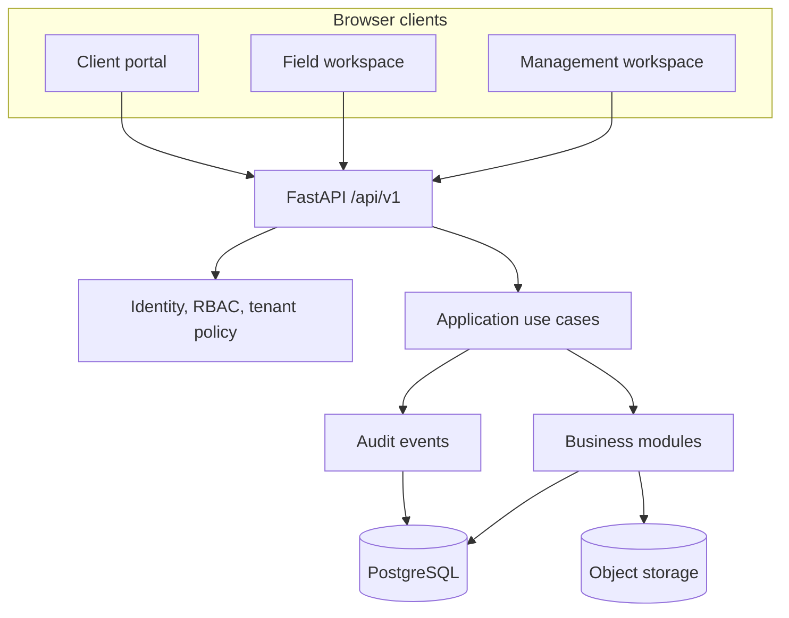

# Veristock One — Product Architecture

**Status:** Proposed MVP architecture  
**Scope:** Full browser-based MVP (management, field operations, client portal)  
**Repository:** `safuh/Veristock`  
**AI policy:** No AI integration or AI scaffolding in the MVP.

## 1. Product shape

Veristock One is a multi-tenant inventory verification and stocktaking platform operated by Veristock Inventory Solutions Ltd.

It has three browser workspaces backed by one FastAPI application:

1. **Management workspace:** Veristock staff manage client organizations, contacts, quotations, engagements, assignments, employees, quality assurance, billing and business performance.
2. **Field workspace:** assigned employees view work, conduct physical counts, record item condition and batch/expiry details, attach evidence, submit counts and perform authorized recounts.
3. **Client portal:** client users manage their branches and inventory data, provide expected-stock information, monitor assignments, review approved results and download reports.

The workspaces are presentation and navigation boundaries, not security boundaries. Authorization is enforced by the API for every operation.

## 2. Architecture decisions

| Concern | MVP decision |
|---|---|
| Application topology | Modular monolith |
| API | FastAPI, REST/JSON, versioned under `/api/v1` |
| Backend language | Python |
| Request/response contracts | Pydantic v2 |
| Persistence | SQLAlchemy 2.x async |
| Database | PostgreSQL |
| Schema evolution | Alembic; migrations are explicit release operations |
| Browser UI | React + TypeScript |
| Frontend structure | One web app with three role-aware workspaces |
| API client | Generated from FastAPI OpenAPI schema, or typed wrapper generated from the same schema |
| Authentication | Existing JWT primitives, mandatory for application routes |
| Authorization | Organization memberships, RBAC and resource-level policy checks |
| File storage | S3-compatible object storage behind a storage interface |
| Background work | In-process only for small bounded tasks initially; add a worker/queue only when a measured workload requires it |
| Deployment | Docker; Compose for local development |
| Testing | Pytest, API integration tests, frontend tests and end-to-end browser tests |

Do not introduce microservices, Kubernetes dependency, event streaming, a distributed cache, AI libraries, vector stores, or a workflow engine as MVP prerequisites.

## 3. Context and runtime topology



The browser app and API may be deployed behind one HTTPS origin with path routing (for example, `/api` to FastAPI and all other paths to the frontend). This simplifies cookie policy and CORS. Separate origins are also supported with an explicit CORS allowlist.

## 4. Backend module boundaries

The current Python package is a src-layout package at `src/veristock`. Preserve it and extend it by business capability.

Suggested target structure (adapt names to existing modules rather than duplicating them):

```text
src/veristock/
  app.py
  api/
    v1/
      router.py
      dependencies/
  core/
    config.py
    database.py
    security.py
    tenancy.py
    permissions.py
    errors.py
  identity/
  organizations/
  workforce/
  commercial/
  operations/
  inventory/
  stocktaking/
  reconciliation/
  assets/
  reporting/
  audit/
  storage/
alembic/
  versions/
web/
  src/
    app/
    features/
      auth/
      management/
      field/
      client/
      organizations/
      inventory/
      stocktaking/
      reconciliation/
      reports/
    components/
    lib/
tests/
  unit/
  integration/
  e2e/
docs/
  architecture/
```

Each backend module should own:
- SQLAlchemy persistence models and repository implementation;
- Pydantic input/output schemas;
- application use cases/services;
- API router(s), where that module exposes HTTP operations;
- domain validation and state-transition rules;
- focused unit and integration tests.

Avoid a generic repository abstraction that hides domain-specific queries. Keep transaction boundaries at application-service/use-case boundaries. Routers handle HTTP concerns and delegate to application services. Application services must not depend on FastAPI request objects.

### Dependency direction

```text
HTTP router -> application service/use case -> domain rules
                                  |
                                  v
                         repository interface
                                  |
                                  v
                         SQLAlchemy adapter
```

Domain and application code should not import React, FastAPI request objects, or database session globals. Infrastructure adapters implement interfaces consumed by application services.

## 5. Tenant isolation and authorization

### Organization model

An `Organization` represents either:
- the Veristock platform organization; or
- a client business tenant.

A `User` may have multiple `OrganizationMembership` records. A membership has a status and one or more roles. Branches belong to client organizations.

Do not use a single global role column on User. Roles are contextual to an organization membership. Platform-level permissions are separate from client-tenant permissions.

### Authorization checks

Every protected request must:
1. authenticate the user;
2. resolve an active membership and active organization context;
3. verify the permission required by the operation;
4. verify that the target resource belongs to that organization or is explicitly accessible to the platform role;
5. apply resource-level restrictions (assignment membership, branch scope, approval authority);
6. write an audit event for security-sensitive and business-significant changes.

Never trust an organization ID, branch ID, assignment ID, or user ID supplied by the browser without checking the relationship. Apply tenant filters in repository queries, not only after loading an unrestricted record.

Use deny-by-default authorization. Hiding a button in the frontend is not access control.

### Initial role catalogue

Platform roles:
- Platform Owner
- Operations Manager
- Stocktaking Supervisor
- Field Employee (internal workforce identity only)
- Finance Officer

Client roles:
- Client Administrator
- Client Manager
- Client Reviewer
- Client Read-only
- Field Counter (granted only for the duration/scope of assigned client work)

A Veristock field employee receives a client-side Field Counter membership when assigned to that client's work. That membership permits entry to the client tenant, but assignment and branch-level APIs must additionally verify the employee's active AssignmentMember record. The role must not grant general client inventory or commercial access. Revoking the assignment must revoke or deactivate the corresponding scoped membership/grant.

Roles are permission bundles, not hard-coded branches in route handlers. Permissions should be granular, for example:
- `organization.read`, `organization.manage`
- `branch.read`, `branch.manage`
- `engagement.create`, `engagement.approve`
- `assignment.manage`, `assignment.perform`
- `inventory.read`, `inventory.import`, `inventory.manage`
- `stocktake.count`, `stocktake.submit`, `stocktake.recount`
- `reconciliation.run`, `reconciliation.review`, `reconciliation.approve`
- `report.read`, `report.publish`
- `billing.manage`

The initial role-to-permission matrix is a product configuration to verify during implementation. Enforce separation of duties: a counter must not approve their own count or reconciliation result by default.

## 6. Authentication and browser security

Reuse the existing password hashing, access/refresh token and refresh-token rotation primitives after reviewing their current implementation and tests. Make identity mandatory for all application routes except health/readiness and explicitly public invitation/activation endpoints.

Current implementation status and target browser design:
- Existing access/refresh JWT issuance and refresh-token rotation are retained.
- When JWT_SECRET_KEY is configured, the FastAPI composition root automatically creates the SQLAlchemy authentication application and matching TokenService; custom implementations can be injected. The issuer and validator use the same configured secret and algorithm.
- Protected identity endpoints currently use short-lived bearer access tokens.
- Active organization context is selected with `X-Organization-ID`, then verified against persisted active membership. The header selects context; it does not grant access.
- Public self-registration is disabled by default. Controlled environments may explicitly enable it; production onboarding should use invitations.
- A one-time `scripts/bootstrap_platform_admin.py` command creates the initial platform organization and owner membership after migrations are applied.

Browser cookie flow implemented:
- Browser clients use POST /api/auth/browser/login, /api/auth/browser/refresh and /api/auth/browser/logout.
- Refresh tokens are stored in an HttpOnly cookie and are never returned in browser endpoint responses.
- Browser refresh/logout require a double-submit CSRF token in the X-CSRF-Token header matching the CSRF cookie.
- In production, cookies are Secure, SameSite=Lax, host-only and use the __Host- prefix. Local development uses non-Secure cookies over localhost HTTP.
- The legacy JSON-body refresh/logout endpoints remain for non-browser clients. Browser applications must not use them or store refresh tokens in localStorage.

Remaining before production:
- enforce HTTPS and same-origin deployment policy;
- add login, invitation and password-recovery rate limiting;
- implement single-use, hashed and time-limited invitation/password-reset tokens;
- verify cookie, CSRF and CORS behavior in the production browser deployment.

Do not expose password hashes, token hashes or internal security metadata through API schemas.

## 7. Core business workflows

### 7.1 Client onboarding and commercial setup

1. Veristock creates or verifies a client organization and its branches.
2. Client contacts are recorded and invited to the client portal.
3. Veristock prepares a quotation with scope, locations, service lines, assumptions, price and validity.
4. An accepted quotation is converted into an engagement.
5. The engagement is divided into one or more assignments with locations, schedule, team and deliverables.

Commercial status changes must be auditable. An engagement should retain a snapshot of the accepted scope and commercial terms; later quotation edits must not silently alter an active engagement.

### 7.2 Inventory onboarding

1. Client supplies an inventory file or enters items through the portal.
2. The import is stored as an immutable source artifact.
3. A parser validates columns, types, units, duplicate keys and required fields.
4. User reviews validation errors and mapping before committing.
5. A committed import creates a versioned expected-stock snapshot for the relevant branch and stocktake cut-off.
6. Import batches and snapshot provenance remain available for audit.

Do not overwrite historical inventory snapshots. A corrected import creates a new version and records who committed it and when.

### 7.3 Physical stocktaking

1. Supervisor creates a stocktake under an assignment and selects branches, zones, scope and cut-off.
2. Expected-stock snapshot is frozen for reconciliation.
3. Count tasks are allocated to authorized field employees.
4. Counters see only the information required to identify and count items; system quantities remain hidden (blind count).
5. Each physical observation records item identity, counted quantity, unit, location, condition and relevant lot/serial/expiry data.
6. Evidence may be attached where required.
7. Counter submits a count round. Submitted observations are immutable.
8. Supervisor may request a recount. Recount creates a new round linked to the prior round; it does not overwrite submitted data.
9. Supervisor closes the count only after required tasks and exceptions are resolved.

### 7.4 Reconciliation and approval

1. A reconciliation run pairs the frozen expected-stock snapshot with the selected approved count observations.
2. Variance is calculated by the configured matching key (normally branch + location + item + unit, with lot/serial dimensions where applicable).
3. Unmatched expected items, unrecognized physical items, duplicate observations and unit mismatches are explicit exceptions.
4. A supervisor reviews exceptions and may request recount or correct master-data mappings with an audit trail.
5. An authorized reviewer approves and locks the reconciliation result.
6. Only approved results can be published to the client portal or included in a final report.

Quantity variance is `physical_quantity - expected_quantity`. Monetary variance is calculated only where a verified unit cost and currency are available. Never infer cost or silently convert units.

### 7.5 Reporting

Reports are generated from approved, versioned reconciliation and verification data. Draft reports must be distinguishable from approved/published reports. Each published report records its source run/version, author, approver, generation time and file checksum.

## 8. Data integrity and audit

- Use UUID primary keys and UTC timestamps.
- Store business dates and stocktake cut-off timestamps explicitly; preserve the client's local timezone where scheduling requires it.
- Use Decimal/numeric for quantities and money; never floating-point for financial values.
- Store quantities with explicit units of measure and controlled conversion rules.
- Use explicit state machines for quotation, engagement, assignment, count round, reconciliation and report publication.
- Use database constraints for uniqueness and referential integrity.
- Use optimistic concurrency/version fields for records that may be edited by multiple users.
- Submitted counts, committed inventory snapshots and approved reconciliation results are immutable. Corrections are new records or explicit superseding versions.
- Audit events record actor, organization context, action, target, timestamp, request/correlation ID and a minimal before/after change summary. Do not log passwords, tokens or sensitive file contents.
- Store file metadata in PostgreSQL and file bytes in object storage. Use generated object keys, size/type limits, malware scanning where available, and short-lived signed download URLs.

## 9. Frontend workspaces

A single React application can provide three navigational workspaces with shared design-system components and shared authentication handling.

### Management workspace
- overview dashboard;
- clients, branches and contacts;
- employees and availability;
- quotations and engagements;
- assignments, schedules and teams;
- stocktake progress and supervisor queues;
- reconciliation review and approval;
- reports, invoices and payment status;
- audit history.

### Field workspace
- assigned work and daily schedule;
- assignment and branch instructions;
- count tasks and blind-count screens;
- barcode/manual item lookup;
- quantity, unit, batch, expiry and condition capture;
- evidence capture/upload;
- draft, submit and recount flows;
- sync/error status.

### Client portal
- organization and branch profile;
- user invitations and permissions;
- inventory catalogue and imports;
- expected-stock submission and validation;
- assignment status and milestones;
- review of approved findings;
- report downloads and historical engagements.

The field workspace should be responsive and installable as a PWA if feasible, but robust offline synchronization is a separately gated enhancement. Do not claim offline support until conflict resolution, local encryption, retry, duplicate submission protection and sync recovery are implemented and tested.

## 10. Non-functional requirements

- Tenant isolation tests for every tenant-owned module.
- Explicit permission tests for both allowed and denied operations.
- Idempotency for import commit, count submission and other retry-prone actions.
- Pagination, filtering and sorting for large lists.
- Database indexes on tenant ID, branch ID, assignment ID, item identifiers and common status/date filters.
- Bounded upload size and content-type validation.
- Structured logs with request IDs; no secrets or unnecessary personal data in logs.
- Database backup and restore procedure tested before production.
- Health and readiness endpoints remain available without authentication.
- API errors use the existing stable error envelope.
- No cross-tenant data in reports, exports, search results or object-storage links.

## 11. MVP delivery sequence

1. **Architecture and domain model:** approve core entities, tenant model, workflows, role matrix and state transitions.
2. **Identity and tenancy:** mandatory authentication, memberships, RBAC, organization context and tenant isolation.
3. **Organizations and workforce:** client setup, branches, contacts, employees and invitations.
4. **Commercial and operations:** quotations, engagements, assignments, schedules and team allocation.
5. **Inventory onboarding:** catalogue, units, imports, validation and immutable snapshots.
6. **Stocktaking:** count plans, blind count, observations, evidence, submissions and recounts.
7. **Reconciliation and QA:** matching, variance, exceptions, review and approval.
8. **Reporting and billing:** approved reports, exports, invoices and payment tracking.
9. **Browser workspaces:** management, field and client portal flows integrated against the API.
10. **Hardening and release:** tenant/security tests, browser E2E, backup/restore, deployment and operational documentation.

The frontend should be started early enough to validate API contracts and workflows, but domain rules remain in the backend.

## 12. Explicit MVP exclusions

- AI/LLM/agent features and AI dependencies;
- vector databases and embeddings;
- native Android/iOS applications;
- automatic integrations to third-party POS/ERP systems unless a specific connector is separately scoped;
- advanced warehouse optimization or perpetual inventory accounting;
- microservices and event-streaming infrastructure;
- offline field operation until the offline-sync gate is explicitly accepted;
- automated tax/accounting compliance claims.

## 13. Acceptance gates

Architecture is not considered implemented merely because files or endpoints exist. Each milestone requires:
- migration upgrade and downgrade verification where applicable;
- unit and API integration tests;
- tenant isolation and authorization regression tests;
- documented API behavior and state transitions;
- browser end-to-end verification for user-visible workflows;
- updated setup and operational documentation.
